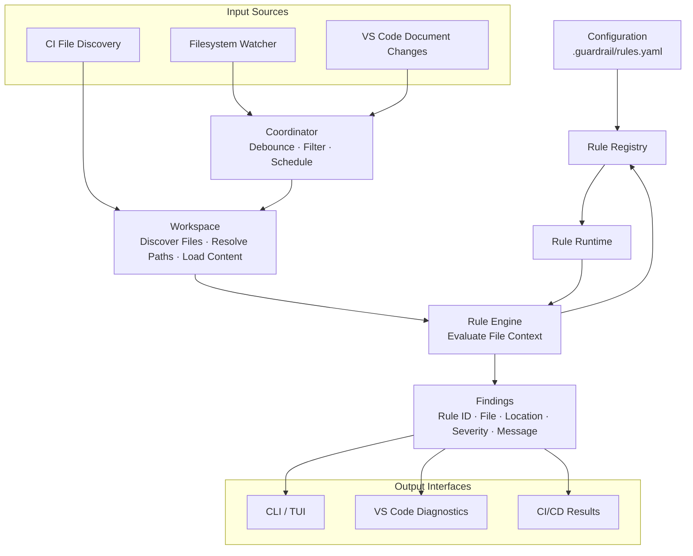

# Guardrail

A terminal workspace for repository engineering standards.

Guardrail aims to provide continuous feedback on repository engineering standards through a shared rule engine, a terminal workspace, editor integrations, and CI/CD pipelines.

The current implementation provides a live filesystem workspace. `guardrail watch` recursively monitors a context directory, displays its hierarchy in a dedicated context pane, and streams changes in the TUI. Rule evaluation, configuration, and analysis are not implemented yet.

## Run

Requires Go 1.26.2 or newer and an interactive terminal.

```sh
make build
./bin/guardrail watch
```

Or run directly:

```sh
go run ./cmd/guardrail watch
```

The context defaults to the directory where you run the command, not the location of the binary or the Git repository root. Supply a relative or absolute directory to watch another context:

```sh
./bin/guardrail watch /path/to/project
./bin/guardrail watch --context ../project
./bin/guardrail watch -c ../project
```

Use either the positional path or `--context`, not both. The context must exist and be a directory.

### Watch workspace

- **Theme:** the workspace detects the terminal's light or dark background at startup and uses a matching UI and syntax palette. Terminals without background-query support use `COLORFGBG` when available, otherwise dark mode. Restart Guardrail after changing your terminal theme; it does not poll for theme changes.
- **Dashboard tab:** the default main page, always available with `0` or a click. It currently contains a workspace summary with live entry and changed-file counts; its containers are the home for future functionality. Watch and Content remain available, and watching continues on every tab.
- **Context pane:** a directories-first hierarchy, including hidden and Git-ignored entries. The context root starts expanded to show its immediate files and folders; child folders and newly discovered folders start collapsed. Expand them with Right, Enter, or a click. Collapsed folders are still watched, and explicit expansion choices survive updates.
- **Change markers:** `[A]` marks added entries, `[M]` marks modified entries, and `[*]` marks folders containing changes, including collapsed folders. Changed files use the purple activity highlight; changed folders use green for additions and yellow for modifications. Markers persist for the current watch session, independently of the change history; they are not Git status. Deleted entries disappear, but their surviving ancestors remain marked and their deletion is recorded in Watch.
- **Dancing dots:** recently changed files animate for two seconds after their latest change, advancing every 200 ms without input. The purple highlight and `[A]` / `[M]` badges persist after the dots settle. Folder markers stay static; collapsed files do not cause animation redraws.
- **Scrollbars:** contrasting blue thumbs and subtle tracks show scroll position. Click the track to move a page; drag the thumb to move through the tree, Watch history, or Content. Dragging remains captured outside the track until release.
- **Watch tab:** the latest 200 changes, newest first, with timestamps and context-relative paths. New updates follow automatically while at the top; scrolling back preserves your place until those entries leave the retained history.
- **Content tab:** a read-only, line-numbered preview of the selected file. Click a file or press `Enter` to open it. While Content is active, moving the tree selection previews the newly selected file. The preview refreshes automatically when that file changes. Syntax highlighting is detected from the filename using Chroma (including Go, JavaScript/TypeScript, Python, Rust, JSON, YAML, shell, and many other languages); unknown filenames use plain text.
- **Live change cursor:** when the previewed text changes, Content follows the latest changed region, highlights its line with a `>` gutter marker, and shows a purple cursor block at the edit boundary. Deletions point at the surviving boundary. This location is inferred from successive on-disk snapshots, not the actual cursor in your editor; multiple edits between snapshots are treated as one region. You can scroll manually until the next text change.
- Content supports vertical and horizontal scrolling. Previews are limited to UTF-8 regular files up to 1 MiB and 20,000 lines to keep the TUI responsive. Binary files, symlinks, oversized files, and read errors show an explicit message instead. Tabs display as four spaces, CRLF line endings are normalized, and other control characters are escaped.
- Creations, modifications, permission changes, and deletions update the workspace automatically. Renames appear as deletions at the old paths and creations at the new paths. Newly created or moved-in folders are discovered recursively.
- Filesystem bursts are coalesced over 20 ms and reconciled with the current directory state; this is a live workspace, not a lossless audit log of short-lived files or individual writes.
- Symlink entries are displayed without descending into them. A symlink supplied as the context root is resolved to its target.
- Watch setup, permission, and runtime errors are reported explicitly. Removing or renaming the context root stops the watch with an error.

### Performance model

- Filesystem notifications are event-driven, not polled, and batched over 20 ms. An indexed path/children map refreshes only touched entries, recursively discovers newly created or moved-in subtrees, and removes deleted subtrees from the index. Ordinary changes do not rescan or copy the entire context.
- The watcher delivers metadata deltas after its initial snapshot. The TUI applies ordinary writes directly to indexed entries and visible rows, without rebuilding the tree. Structural changes update affected child lists; expanding/collapsing flattens the cached hierarchy without rediscovering files.
- Both the tree and file preview create a bounded window of row elements with spacers retaining their full scroll range. Syntax tokens for the selected file are still cached in memory, subject to the preview size limits.
- File reads, change-location comparison, and full-file syntax highlighting run on one background worker. Requests are coalesced for 40 ms with at most one running and one latest pending request. Stale results cannot replace a newer request or another selected file. Errors are displayed in Content.
- Animation reuses existing elements. Its timer stops entirely when no recent activity remains. Uninteracted mouse movement does not force redraws.
- Input and updates share a pending frame at most once per 16 ms instead of rebuilding the layout for every wheel/drag event. Wheel movement accumulates before rendering. Frame timers stop when idle, and a bounded eight-update queue lets the watcher absorb short UI stalls without dropping updates.
- Structural batches filter each affected sibling list once, then sort it once, avoiding repeated sibling scans for every changed path. Flattening reuses row storage.
- History reuses bounded storage for the latest 200 events. Metadata and OS watch resources still grow with the number of tracked entries/directories. All files remain included: dependency folders, generated output, and Git internals are not silently excluded.
- On macOS, kqueue monitoring opens descriptors for watched files as well as directories. Terminal input resources are initialized first so large contexts do not exceed the terminal reader's `select` descriptor range; OS open-file limits still apply.

Focused microbenchmarks on an Apple M3 Pro (not end-to-end latency guarantees):

| Workload | 1,000 indexed entries | 100,000 indexed entries |
| --- | --- | --- |
| Single-write watcher reconciliation | about 3.1 us, 712 B | about 3.0 us, 712 B |
| Previous full-copy/diff comparison | about 107 us, 222 KB | about 16 ms, 16 MB |
| TUI metadata delta application | about 0.36 us, 0 allocations | about 0.36 us, 0 allocations |

Run the benchmarks with `go test ./internal/watcher ./internal/tui/screens -run '^$' -bench 'Benchmark(SingleWriteBatch|MetadataDelta|ActivityFrame)$' -benchmem`.

Initial discovery still visits the whole context. Large structural batches can still rebuild the visible row list, and the preview worker re-highlights the selected file rather than using an incremental lexer. An in-progress highlighting operation finishes before worker shutdown; newer requests replace pending work, not the running lexer. Filesystem queue overflow and watch-limit failures are surfaced as errors rather than silently dropping changes.

| Input | Action |
| --- | --- |
| `0` / `1` / `2`, or click a tab | Switch between Dashboard, Watch, and Content. |
| `Tab` | Switch focus between the context tree and the active tab. |
| Up/Down or `k`/`j` | Move the tree selection or scroll the active tab. |
| Right/`l` | In the tree: expand a folder or select its first child. In Content: scroll right. |
| Left/`h` | In the tree: collapse a folder or select the parent. In Content: scroll left. |
| `Enter` / `Space` | Toggle the selected folder or open the selected file in Content. |
| `Home` / `End` | Jump to the first/last tree entry, retained change, or content line. |
| `PageUp` / `PageDown` | Move by a page in the active pane. |
| Left click | Focus a pane; select a tree entry, toggle folders, or open a file. |
| Mouse wheel | Scroll the pane under the pointer. |
| `r` | Reload the selected file preview (also retries read errors). |
| `q` / `Ctrl+C` | Quit and restore the terminal. |

Mouse input requires a terminal supporting mouse reporting. The layout resizes with the terminal.

### Workspace layout

The edge-to-edge workspace keeps the context tree visible beside the Dashboard/Watch/Content tabs:

- A four-row navbar with a subtly contrasting, theme-matched background shows the workspace name and context basename; the full context path appears in Watch's breadcrumb.
- The sidebar is up to 38 columns wide and shrinks to roughly 30% on narrower terminals; the active tab fills all remaining width, with no trailing blank panel.
- Underlined blue tabs identify the active page without filled buttons. Accent headings identify keyboard focus; the bottom status bar also names the focused pane.
- Theme-matched sidebar and editor surfaces are separated by a subtle one-column divider. Selection uses tinted backgrounds rather than bright solid blocks; changed files retain purple activity styling.
- Watch events have muted timestamps and colored kinds: green for creations, yellow for modifications, and red for deletions.
- A quiet, padded footer shows watching status, entry and changed-file counts, focus, and essential keyboard hints. Hints shorten on narrower terminals. The Content breadcrumb shows the selected file, language, and size.
- There are no outer margins: panel backgrounds fill the terminal. Internal padding keeps content two columns from panel edges and at least one row from the top and bottom of each panel, navbar, and footer. Headings and tab rows occupy one line each. At 80x24, the tree has 14 visible rows and the main viewport has 13.

## Architecture

The planned architecture separates rule evaluation from the interfaces that consume its results. Local development, editor integrations, and CI/CD will use the same rule definitions and evaluation logic.



## Go Components

The target Go package structure is:

```text
guardrail/
|-- cmd/
|   `-- guardrail/
|       `-- main.go
|-- internal/
|   |-- cli/
|   |   |-- root.go
|   |   |-- check.go
|   |   `-- watch.go
|   |-- config/
|   |   |-- types.go
|   |   |-- loader.go
|   |   `-- validator.go
|   |-- workspace/
|   |   |-- workspace.go
|   |   |-- discover.go
|   |   `-- file.go
|   |-- watcher/
|   |   |-- watcher.go
|   |   `-- events.go
|   |-- coordinator/
|   |   |-- coordinator.go
|   |   `-- scheduler.go
|   |-- engine/
|   |   |-- engine.go
|   |   |-- context.go
|   |   `-- finding.go
|   |-- rules/
|   |   |-- rule.go
|   |   |-- registry.go
|   |   |-- runtime.go
|   |   `-- javascript.go
|   |-- output/
|   |   |-- text.go
|   |   `-- json.go
|   `-- tui/
|       |-- app/
|       |   `-- app.go
|       |-- components/
|       |   |-- container.go
|       |   |-- header.go
|       |   |-- layout.go
|       |   |-- section.go
|       |   `-- sidebar.go
|       |-- screens/
|       |   `-- main.go
|       `-- styles/
|           `-- theme.go
|-- editors/
|   `-- vscode/
|-- .guardrail/
|   `-- rules.yaml
|-- Makefile
|-- go.mod
|-- go.sum
|-- README.md
`-- LICENSE
```

This is the planned target structure. Packages and files will be introduced as their functionality is implemented. The VS Code extension will be a separate TypeScript project.

### Component responsibilities

| Package | Responsibility |
| --- | --- |
| `cli` | Define commands such as `check` and `watch`. |
| `config` | Load and validate `.guardrail/rules.yaml`. |
| `workspace` | Discover files, resolve paths, normalize file addresses, and provide file content. |
| `watcher` | Resolve the context, discover entries, manage recursive filesystem watches, and reconcile coalesced changes. |
| `coordinator` | Debounce events, filter changes, and schedule evaluations. |
| `engine` | Evaluate applicable rules and collect findings. |
| `rules` | Define the rule interface, registry, and rule execution runtime. |
| `output` | Format findings as terminal text or JSON. |
| `tui` | Display live findings in the terminal workspace. |

### Rule evaluation contract

Every rule receives a file context containing the file path, repository root, content, and detected language.

The intended flow is:

```text
FileContext -> Rule Evaluation -> Findings
```

A rule can return zero or more findings. Each finding can contain a rule ID, file path, line, column, severity, and message. Rule execution errors are handled separately from policy violations.

The engine does not read files directly. The workspace layer, editor integration, or another input source provides the file context. For editor integrations, content comes from the current document buffer so unsaved changes can be analyzed.

### Execution modes

- **`guardrail watch [context-path]`**: Monitor context changes and display the live hierarchy and change feed. Findings will be added when rule evaluation is implemented.
- **`guardrail check`**: Analyze repository files once and return an appropriate exit code for CI/CD.
- **VS Code extension**: Display findings as editor diagnostics using the shared Go engine.

All execution modes use the same rule evaluation logic.

## Building Screens

- Keep source and test files at or below 300 lines; split by responsibility rather than adding runtime enforcement.
- The main screen separates state updates (`main.go`), hierarchy indexing (`hierarchy.go`), rendering (`render.go`), navigation (`navigation.go`), preview loading/rendering (`content.go`), and file reading/highlighting (`highlight.go`).
- `cli` defines commands and delegates terminal startup to `tui/app`.
- `tui/app` owns terminal startup, event dispatch, and cleanup.
- `tui/screens` composes pages and defines screen-level key bindings.
- `tui/components` provides composable containers, borderless sections, headers, sidebars, and the main layout using go-tui elements.
- `tui/styles/theme.go` defines all application colors. Pass the same theme through the screen and its components.

Use containers to arrange children and sections to group content:

```go
theme := styles.Default()
section := components.NewSection(theme, "Diagnostics",
    tui.New(tui.WithText("No diagnostics yet.")),
)
content := components.NewContainer(theme,
    tui.WithFlexGrow(1),
    tui.WithGap(1),
)
content.AddChild(section)
```

Containers accept go-tui options, so rows, columns, spacing, sizing, and scrolling can be composed without adding wrapper types. Child text inherits the container theme unless explicitly styled.

`NewLayout` accepts header, sidebar, and content elements independently, plus optional footer elements; replace their contents without changing app startup. Sections use surface backgrounds and optional text headings without borders.

The layout uses a three-row header, no outer margins, and a one-column sidebar-content divider. Generic sections have one-column horizontal padding; the main screen applies two-column horizontal insets and one row above its panels. The screen supplies a single-row status/help footer outside the scrollable body.

Font size follows your terminal settings. The sidebar is up to 38 columns wide and shrinks to roughly 30% on narrower terminals; content fills all remaining space through the header's right edge.

## Development

```sh
make build
make test
go