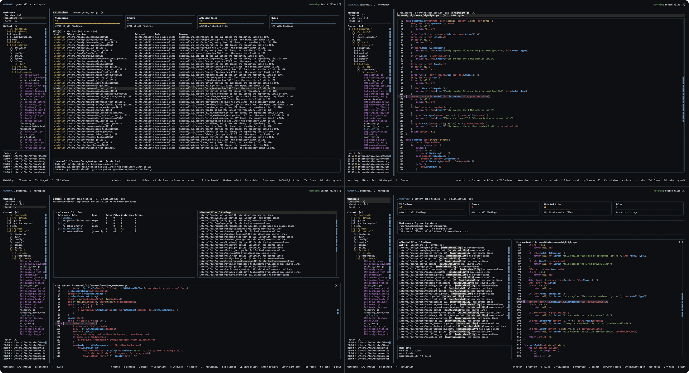

# Guardrail

**Real-time engineering standards for AI-assisted development.**

Guardrail is an open-source CLI being built to check code changes against a
repository's engineering standards. Instructions tell coding agents what to do;
Guardrail's goal is to verify the result and explain violations as they happen.



**Current status:** recursive watching, Tree-sitter parsing, YAML-defined regex and
JavaScript rules, live findings, and `guardrail check` are implemented.
Agent/editor integrations and dependency-aware rules remain planned.
Policies are repository-defined, not built in.

## Table of contents

- [What you can do today](#what-you-can-do-today)
- [Getting started](#getting-started)
- [Using the workspace](#using-the-workspace)
- [Documentation](#documentation)
- [Contributing](#contributing)
- [Community and support](#community-and-support)
- [License](#license)

## What you can do today

- Watch the current directory or another context recursively.
- Browse a live file tree with keyboard and mouse controls.
- See added and modified files, animated activity, and a recent change feed.
- Preview files with syntax highlighting and an inferred live edit cursor.
- Navigate Overview, Violations, and Rules above the Context tree, with Watch
  below it and an on-demand Content tab in a light- or dark-themed terminal UI.
- Run regex and restricted JavaScript functions from YAML rule sets under `.guard/`, inline or
  referenced from `.guard/` or `.guardrail/`.
- Parse Go, JavaScript, TypeScript, Python, and Rust and inspect live findings.
- Run `guardrail check --format json` for noninteractive checks.

Watching uses filesystem notifications, not periodic full-directory polling.
Overview shows analysis status; Violations distinguishes policy findings from
execution errors. Missing configuration never implies a successful check.

## Getting started

You need **Go 1.26.2 or newer**, Git, and a C compiler for Tree-sitter (CGO enabled).
Watching also requires an interactive terminal.
Build from source:

```sh
git clone https://github.com/MoeidHeidari/guardrail.git
cd guardrail
go build -o bin/guardrail ./cmd/guardrail
./bin/guardrail watch
```

Or, from the cloned repository:

```sh
go run ./cmd/guardrail watch
```

To watch another project:

```sh
./bin/guardrail watch /path/to/project
# Alternatively:
./bin/guardrail watch --context ../project
```

Without a path, Guardrail watches the directory where you run the command.
It does not automatically select the Git root. Use either a positional path or
`--context` (`-c`), not both.

See [Getting started](docs/GETTING_STARTED.md) for setup details and troubleshooting.
See [Rules and checking](docs/RULES.md) for configuration, JavaScript contracts,
analysis scope, and exit codes. This repository includes runnable
[General rules](.guard/rules.yml), [maintainability rules](.guard/maintainability/source.yml),
[Go rules](.guard/go/quality.yaml), and an [inline example](examples/rules/inline.yml).

## Using the workspace

The context tree opens one level deep. Child folders remain collapsed until opened.

| Action | Control |
| --- | --- |
| Workspace tab / content tab N / next-previous tab | `0` / `1`-`9` / `>` `<` |
| Overview / Violations / Rules / Context / Watch | `o` / `v` / `u` / `c` / `w` (shown in the sidebar) |
| Open an item and focus it / go back | Right or `Enter` / Left or `Esc` |
| Switch pane focus | `Tab` |
| Navigate | Arrow keys or `h` / `j` / `k` / `l` |
| Toggle a folder or preview a file | `Enter`, `Space`, or click |
| Scroll | Mouse wheel, `PageUp` / `PageDown`, or drag a scrollbar |
| Scroll horizontally | `[` / `]` in the focused pane; Shift+wheel over Context or Watch |
| Close a preview | Click `[x]` or press `x` |
| Quit | `q` or `Ctrl+C` |

`[A]` means added, `[M]` means modified, and `[*]` marks an affected ancestor folder.
These are session change markers, **not Git status**.

Previews are read-only and limited to UTF-8 regular files up to 1 MiB and 20,000
lines. The root [`.guardignore`](.guardignore) excludes paths from
watching, the context tree, and checking using Git-style patterns.
Git's own ignore files are not loaded.
Large contexts remain subject to OS watch and open-file limits.

See the [watch guide](docs/WATCH.md) for complete controls and behavior.

## Documentation

| Guide | What it covers |
| --- | --- |
| [Documentation index](docs/README.md) | All guides, grouped by audience |
| [Getting started](docs/GETTING_STARTED.md) | Build, launch, context selection, troubleshooting |
| [Watch workspace](docs/WATCH.md) | Tabs, tree, content preview, markers, keyboard and mouse |
| [Rules and checking](docs/RULES.md) | YAML, regex, JavaScript, parsing, live results, CLI checks |
| [Performance and limits](docs/PERFORMANCE.md) | Event processing, large contexts, benchmarks, resource limits |
| [Architecture and roadmap](docs/ARCHITECTURE.md) | Implemented components and future integrations |
| [Development](docs/DEVELOPMENT.md) | Local checks, tests, project structure, TUI composition |
| [Contributing](docs/CONTRIBUTING.md) | Issues, pull requests, code style, conventional titles |
| [Code of conduct](docs/CODE_OF_CONDUCT.md) | Community expectations and private reporting |
| [Security policy](docs/SECURITY.md) | Responsible vulnerability reporting |
| [Support](docs/SUPPORT.md) | Bug reports, feature requests, troubleshooting information |

## Contributing

Bug reports, documentation improvements, tests, and focused code contributions
are welcome. Read the [contribution guide](docs/CONTRIBUTING.md) before opening a PR.
Keep source and test files at or below 300 lines and include tests for behavior
changes. Proposed features should clearly distinguish planned functionality
from currently supported behavior.

## Community and support

- [Report a bug or propose a feature](https://github.com/MoeidHeidari/guardrail/issues).
- Follow the [code of conduct](docs/CODE_OF_CONDUCT.md).
- Report vulnerabilities privately using the [security policy](docs/SECURITY.md),
  not a public issue.

## License

Guardrail is licensed under [Apache License 2.0](LICENSE).
