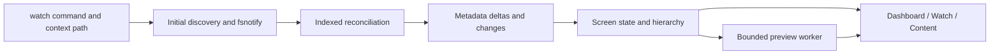
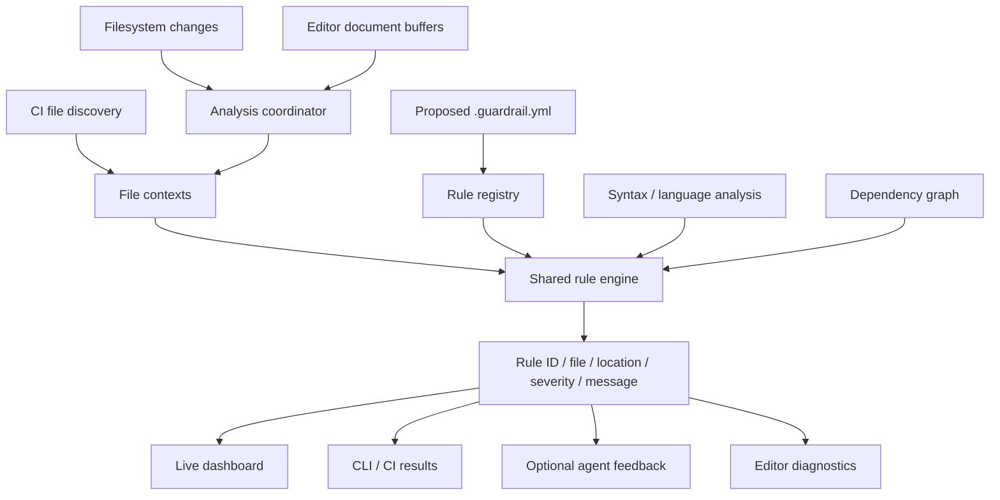

# Architecture and roadmap

[Documentation index](README.md)

## Product direction

Guardrail aims to validate repository-defined engineering standards during
AI-assisted development. A file such as `AGENTS.md` can instruct an agent;
Guardrail's intended role is to independently inspect changed code and explain
where it violates repository policy.

The rules should apply to human and agent edits alike. Filesystem events do not
identify authorship. Local monitoring detects saved changes; editor integration
would be needed to analyze unsaved buffers.

## Implemented today



| Location | Responsibility |
| --- | --- |
| [cmd/guardrail](../cmd/guardrail/) | Executable entry point |
| [internal/cli](../internal/cli/) | Cobra commands and context arguments |
| [internal/watcher](../internal/watcher/) | Root resolution, recursive watches, indexes, reconciliation |
| [internal/tui/app](../internal/tui/app/) | Startup, event loop, frame scheduling, cleanup |
| [internal/tui/screens](../internal/tui/screens/) | State, hierarchy, navigation, tabs, previews, activity |
| [internal/tui/components](../internal/tui/components/) | Reusable containers, sections, header, sidebar, layout |
| [internal/tui/styles](../internal/tui/styles/) | Light/dark palettes and startup detection |

The watcher emits a full initial snapshot, then upserts, removals, and change
records. UI indexes avoid rebuilding hierarchy for ordinary metadata writes.
Preview results carry request identities so outdated work cannot overwrite
newer state. Screen mutation and result acceptance belong to the UI loop.

See [Performance and limits](PERFORMANCE.md) for batching, virtualization,
backpressure, and resource boundaries.

## Planned standards pipeline

The following components are proposals, **not implemented APIs or commands**:



### Proposed responsibilities

| Component | Intended responsibility |
| --- | --- |
| Configuration | Load and validate repository rules, proposed in `.guardrail.yml` |
| Workspace | Discover analysis inputs, resolve paths, provide content and language |
| Coordinator | Select affected files, coalesce work, track versions, reject stale results |
| Engine | Evaluate applicable rules independently of the UI |
| Rule registry/runtime | Define rule contracts and execute registered checks |
| Language analysis | Syntax-aware checks, potentially Tree-sitter and specialized analyzers |
| Architecture analysis | Dependency tracking and forbidden cross-layer relationships |
| Output | Shared findings rendered as terminal text, structured data, or diagnostics |
| Agent integrations | Deliver actionable feedback through explicit integrations/hooks |

Configuration syntax, analyzer selection, runtime interfaces, and integration
protocols still need design. Earlier sketches used `.guardrail/rules.yaml`;
the current product proposal uses `.guardrail.yml`. Neither path is loaded today.
Do not treat example plans as a supported configuration contract.

### Rule evaluation contract

The intended data flow is:

```text
File context -> applicable rules -> findings
```

A file context should contain a path, context/repository root, content, and detected
language. A finding should identify a rule, file, location, severity, and explanation.
Execution failures must remain distinct from policy violations.

The engine should consume supplied content rather than own terminal behavior or
filesystem watching. That keeps the same evaluation usable for disk snapshots,
editor buffers, and CI.

## Roadmap

1. **Configuration and first rule:** validate `.guardrail.yml` and implement a
   maximum-file-length rule without needing a syntax parser.
2. **Live findings:** perform startup analysis, recheck changed files, clear
   resolved/deleted findings, and show exact locations on Dashboard.
3. **One-shot checking:** introduce a planned `guardrail check` command using the
   same engine, with explicit exit semantics and structured output for CI.
4. **Syntax-aware rules:** add comment and function-length checks, then expand
   language support according to tested analyzer capabilities.
5. **Architecture rules:** incrementally track dependencies and affected dependents.
6. **Agent/editor integrations:** deliver findings to supported tools and optionally
   analyze unsaved document buffers.

Examples of intended policies include no source comments, at most 300 lines per
file, at most 40 lines per function, and forbidden architectural dependencies.
None are currently enforced by the application.

## Design boundaries

- Share evaluation and finding semantics across TUI, CLI, CI, and integrations.
- Keep browsing scope separate from future analysis exclusions.
- Reuse unaffected results and invalidate dependent results when required.
- Track content versions so rapid saves cannot publish obsolete findings.
- Surface failures instead of substituting an empty, success-shaped result.
- Do not describe saved-file monitoring as blocking edits. Preventing merges
  requires CI checks; agent correction requires a supported feedback integration.
- Add packages when their functionality exists, not an empty speculative tree.
