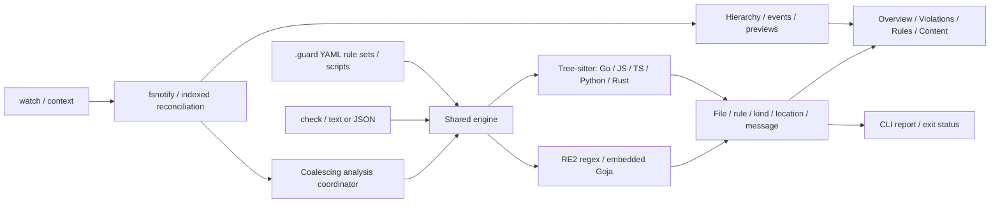

# Architecture and roadmap

[Documentation index](README.md)

## Product direction

Guardrail validates repository-defined engineering standards during human and
AI-assisted development. Filesystem events do not identify authorship; analysis
sees saved file snapshots, not unsaved editor buffers.

## Implemented pipeline

| Location | Responsibility |
| --- | --- |
| [cmd/guardrail](../cmd/guardrail/) | Executable entry point |
| [internal/cli](../internal/cli/) | Cobra commands, context, output and exit semantics |
| [internal/config](../internal/config/) | Strict YAML validation and analysis scope |
| [internal/analysis](../internal/analysis/) | Parsing, rule runtime, reports, disk check and live coordinator |
| [internal/watcher](../internal/watcher/) | Recursive watches, indexes and reconciliation |
| [internal/tui/app](../internal/tui/app/) | Terminal lifecycle, event loop, workers and frame scheduling |
| [internal/tui/screens](../internal/tui/screens/) | Hierarchy, navigation, findings, previews and activity |
| [internal/tui/components](../internal/tui/components/) | Reusable containers, sections and layout |
| [internal/tui/styles](../internal/tui/styles/) | Light/dark palettes and startup detection |

## Analysis and concurrency

The watcher emits a full initial snapshot, then upserts, removals and change
records. UI indexes avoid rebuilding hierarchy for ordinary metadata writes.
Analysis receives the same updates through a synchronized metadata index and
one-slot wake signal. It runs separately from the UI, caching per-file results
by update version. Changed configuration/scripts invalidate the whole analysis
cache. Deleted paths disappear from the next report. YAML discovery is recursive;
rule IDs are scoped by the containing folder (General at the root), and findings
carry rule-set and YAML source metadata. Each YAML retains its scope and timeout.

The root `.guardignore` uses Git-style matching in both watch and check.
Ignored directories are pruned before adding watches. Changes to the ignore
file rescan the context, reconcile watches, and publish a full metadata snapshot.

New updates cancel running jobs and coalesce into the next snapshot. Reports
carry a generation; only the current generation may update the UI. Preview
workers independently reject outdated request identities. All screen mutations
belong to the terminal event loop.

The shared engine consumes `(context, relative path, content)` independently of
terminal rendering. File discovery/read helpers feed it in both `check` and live
mode. The JavaScript interface is `(path, change)`, with saved content, cached
language-adapted helpers, and a frozen, bounded named-node snapshot under
`change.ast`, with no host filesystem/network APIs. A fresh runtime
per file/rule avoids shared mutable state. The snapshot is captured once per
file evaluation before Tree-sitter trees/parsers are closed.

Parsing errors, read errors, configuration failures and runtime failures remain
distinct from policy violations. Unsupported grammars are explicitly text-only.
No file-length/comment/architecture policy is built in; the repository's
300-line convention is an explicit example rule, not an implicit engine policy.

See [Rules and checking](RULES.md) for the supported schema, runtime contract,
limits and trust boundaries, and [Performance and limits](PERFORMANCE.md) for
watch/preview resource behavior.

## Roadmap

1. Additional tested grammars and richer syntax-aware community rules.
2. Dependency graphs, cross-layer policies and affected-dependent analysis.
3. Severity and richer diagnostic/report integrations.
4. Agent/editor integrations, including unsaved document buffers where supported.
5. CI tooling beyond the current noninteractive `check` command.

## Design boundaries

- Keep browsing scope separate from analysis exclusions.
- Reuse unaffected results and reject stale work.
- Surface errors instead of substituting an empty successful result.
- JavaScript host restrictions are not process or memory isolation.
- Saved-file monitoring does not block edits. Merge prevention requires CI
  handling of check exit codes; agent correction needs an explicit integration.
